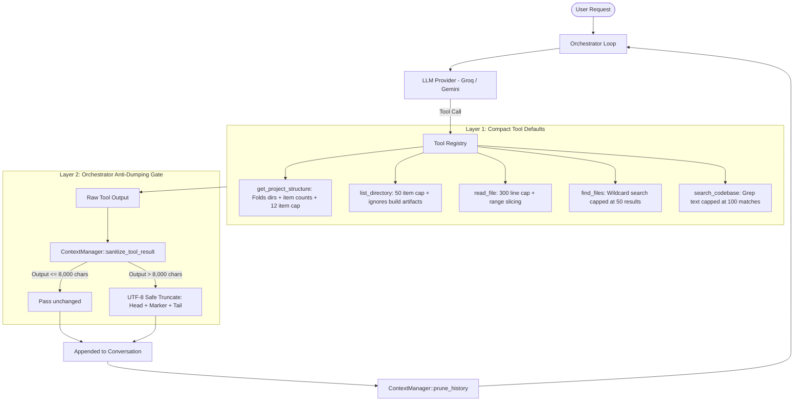
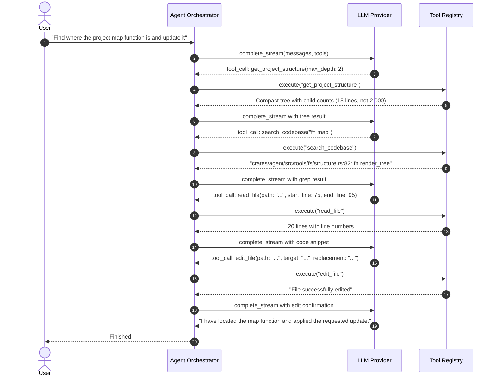

# Workspace Exploration & Orchestrator Anti-Dumping Guide

A detailed architectural and practical reference for how the agent discovers workspace structure, inspects code, and guarantees lean LLM context through compact tools and orchestrator safety limits.

---

## 1. Core Architecture & Design Philosophy

When an AI coding agent operates inside a software repository, the two biggest failure modes are:
1. **Blindness**: The agent does not know where files live, guessing random paths or hallucinating filenames.
2. **Context Blowout (Dumping)**: The agent runs `ls -la`, `cat huge_file.rs`, or a terminal command that dumps tens of thousands of lines into the conversation history. This causes:
   - High token costs and provider rate limiting.
   - Loss of original instructions (context degradation).
   - Potential crashes or multi-byte UTF-8 panics.

### The Dual-Layer Defense



1. **Tool-Level Compacting (Layer 1)**: Every exploration tool defaults to compact summaries. Heavy directories (`.git/`, `target/`, `node_modules/`, `dist/`) are filtered out automatically.
2. **Orchestrator-Level Sanitization (Layer 2)**: Even if a custom tool or command generates megabytes of output, the orchestrator intercepts the result and enforces an 8,000-character safety cap with UTF-8 boundary slicing before sending anything back to the LLM.

---

## 2. Dynamic Workspace Exploration Tools

All tools are located in `crates/agent/src/tools/` and implement the `Tool` trait.

### A. `get_project_structure`
- **File**: [`crates/agent/src/tools/fs/structure.rs`](file:///home/kabir/Desktop/projects/personal/framworks/zenthra-v2/apps/zenthree/crates/agent/src/tools/fs/structure.rs)
- **Risk**: `ToolRisk::ReadOnly`
- **Purpose**: Generates a high-level mental map of the project without dumping entire trees.
- **Parameters**:
  - `path` *(string, optional)*: Root directory to inspect (defaults to `"."`).
  - `max_depth` *(integer, optional)*: Tree expansion depth (defaults to `2`).

#### How it stays compact:
- **Child Summaries**: Instead of listing all 100 files in a folder, folders beyond `max_depth` or leaf folders display child counts:
  ```text
  ├── assets/ [4 files]
  ├── crates/ (5 subdirs)
  │   ├── agent/ (4 subdirs, 2 files)
  │   ├── ai/ (5 subdirs, 1 files)
  │   ├── connectome/ (3 subdirs, 1 files)
  │   ├── editor/ (4 subdirs, 1 files)
  │   └── zenthree/ (4 subdirs, 2 files)
  ├── docs/ (1 subdirs, 1 files)
  └── references/ [3 files]
  ```
- **Directory Capping**: Each directory lists at most 12 items. Remaining entries are collapsed into `└── ... (N more items)`.
- **Automatic Build Artifact Filtering**: Never traverses `.git/`, `target/`, `node_modules/`, `.turbo/`, or `dist/`.

---

### B. `list_directory`
- **File**: [`crates/agent/src/tools/fs/list.rs`](file:///home/kabir/Desktop/projects/personal/framworks/zenthra-v2/apps/zenthree/crates/agent/src/tools/fs/list.rs)
- **Risk**: `ToolRisk::ReadOnly`
- **Purpose**: Targeted drill-down into a specific directory the model or user needs to examine.
- **Parameters**:
  - `path` *(string, optional)*: Directory path (defaults to `"."`).
  - `max_items` *(integer, optional)*: Maximum items to list before capping (defaults to `50`).
  - `show_all` *(boolean, optional)*: Set to `true` to list all entries without capping.
  - `show_hidden` *(boolean, optional)*: Set to `true` to include hidden files and build caches (`.git`, `target`, etc.).

#### Output Format:
```text
[DIR]  assets/
[DIR]  crates/
[DIR]  docs/
[DIR]  references/
[FILE] Cargo.lock (138.4 KB)
[FILE] Cargo.toml (150 B)
[FILE] README.md (6.1 KB)
Total: 4 directories, 3 files
```
If a folder contains 200 items and `show_all` is `false`, it displays the first 50 entries followed by:
```text
... (150 more items capped. Use show_all: true or increase max_items to view all)
Total: 4 directories, 196 files
```

---

### C. `read_file`
- **File**: [`crates/agent/src/tools/fs/read.rs`](file:///home/kabir/Desktop/projects/personal/framworks/zenthra-v2/apps/zenthree/crates/agent/src/tools/fs/read.rs)
- **Risk**: `ToolRisk::ReadOnly`
- **Purpose**: Safe file inspection with 1-indexed line numbers and range bounding.
- **Parameters**:
  - `path` *(string, required)*: Path to the target file.
  - `start_line` *(integer, optional)*: 1-indexed start line.
  - `end_line` *(integer, optional)*: 1-indexed end line (inclusive).
  - `show_all` *(boolean, optional)*: Set to `true` to disable line capping.

#### Anti-Dumping Safeguard:
If the agent requests `read_file` on a 2,000-line file without specifying line numbers:
- It returns lines 1..300 with numbered gutter lines.
- Appends an informative guidance notice:
  ```text
  // ... (1700 more lines omitted. Use start_line: 301 or show_all: true to read further)
  ```
This prevents an LLM from accidentally consuming 80,000 tokens on a single file read.

---

### D. `search_codebase` (Grep)
- **File**: [`crates/agent/src/tools/search/codebase.rs`](file:///home/kabir/Desktop/projects/personal/framworks/zenthra-v2/apps/zenthree/crates/agent/src/tools/search/codebase.rs)
- **Risk**: `ToolRisk::ReadOnly`
- **Purpose**: Locates symbols, function names, keywords, and text occurrences across the codebase when filenames are unknown.
- **Parameters**:
  - `query` *(string, required)*: Search string.
  - `path` *(string, optional)*: Root directory (defaults to `"."`).
  - `case_sensitive` *(boolean, optional)*: Defaults to `false`.
- **Capping**: Hard capped at **100 matches** with an indicator notice. Automatically skips `.git/`, `target/`, and `node_modules/`.

---

### E. `find_files` (Glob / Pattern)
- **File**: [`crates/agent/src/tools/search/files.rs`](file:///home/kabir/Desktop/projects/personal/framworks/zenthra-v2/apps/zenthree/crates/agent/src/tools/search/files.rs)
- **Risk**: `ToolRisk::ReadOnly`
- **Purpose**: Instant path lookup for file patterns (e.g. `*.rs`, `Cargo.toml`, `ai_panel.*`).
- **Parameters**:
  - `pattern` *(string, required)*: Wildcard pattern or filename.
  - `path` *(string, optional)*: Root directory (defaults to `"."`).
- **Capping**: Hard capped at **50 results**.

---

## 3. Tool Matrix Summary

| Tool | Category | Risk | Default Cap | Escape Hatch |
|---|---|---|---|---|
| `get_project_structure` | Structure | ReadOnly | 12 items/dir, depth 2 | Pass `max_depth` |
| `list_directory` | Structure | ReadOnly | 50 items | `show_all: true` or `max_items` |
| `read_file` | File I/O | ReadOnly | 300 lines | `start_line` / `end_line` or `show_all: true` |
| `find_files` | Search | ReadOnly | 50 matches | Narrow `pattern` / `path` |
| `search_codebase` | Search | ReadOnly | 100 matches | Narrow `query` / `path` |
| `edit_file` | Mutation | Mutating | Surgical diff | Target string match |
| `write_file` | Mutation | Mutating | Full file overwrite | Approval gated |
| `run_terminal` | Execution | Destructive | Bounded output | Approval gated |

---

## 4. Orchestrator Anti-Dumping & Context Management

The orchestrator sits above all tools in [`crates/agent/src/orchestrator/`](file:///home/kabir/Desktop/projects/personal/framworks/zenthra-v2/apps/zenthree/crates/agent/src/orchestrator/).

### A. UTF-8 Safe Result Sanitizer
Raw tool results pass through [`ContextManager::sanitize_tool_result`](file:///home/kabir/Desktop/projects/personal/framworks/zenthra-v2/apps/zenthree/crates/agent/src/orchestrator/context.rs#L21):

```rust
pub fn sanitize_tool_result(output: &str, max_chars: usize) -> String
```

#### Why Naive Truncation Panics in Rust:
In Rust, `&str` is indexed by UTF-8 bytes, not characters. Tree formatting glyphs (`├──`, `└──`) are 3 bytes each (`\u{251c}`, `\u{2500}`), and emojis (`🦀`, `📁`) are 4 bytes. Slicing with `&output[..N]` when `N` falls inside a multi-byte sequence causes a fatal process panic:
```text
byte index 4000 is not a char boundary; it is inside '─' (bytes 3999..4002)
```

#### The Safe Implementation:
`ContextManager` finds valid character boundaries using `.char_indices()`:
1. Target head length: `max_chars / 2` (defaults to 4,000 chars). Finds the nearest char boundary `<=` head target.
2. Target tail length: `max_chars / 4` (defaults to 2,000 chars). Finds the nearest char boundary `>=` tail target.
3. Formats output with informative truncation notice:
   ```text
   <head text>
   
   ... [Output truncated: 48,210 total characters. Showing head and tail to prevent context overflow] ...
   
   <tail text>
   ```

### B. Conversation History Pruning
Implemented in [`ContextManager::prune_history`](file:///home/kabir/Desktop/projects/personal/framworks/zenthra-v2/apps/zenthree/crates/agent/src/orchestrator/context.rs#L9):
- **Turn 0 Preservation**: The initial user request is never pruned.
- **Intermediate Drop**: When history exceeds `max_history_messages` (default 50), intermediate completed tool calls and assistant turns are drained from index 1 forward.
- **Active Turn Preservation**: The latest tool results and current turn context are kept intact so the model always knows its immediate next step.

### C. Configurable Tunable Knobs (`AgentConfig`)

Located in [`crates/agent/src/orchestrator/config.rs`](file:///home/kabir/Desktop/projects/personal/framworks/zenthra-v2/apps/zenthree/crates/agent/src/orchestrator/config.rs):

```rust
pub struct AgentConfig {
    pub max_iterations: usize,        // Max agent loops (default: 10)
    pub auto_approve_all: bool,        // Dev mode auto-approval vs production gate
    pub max_provider_retries: usize,   // Network retries on 5xx / rate limits (default: 2)
    pub max_history_messages: usize,   // Turn memory cap (default: 50)
    pub max_tool_output_chars: usize,  // Hard output cap per tool (default: 8000)
    pub cancellation_token: Option<Arc<AtomicBool>>, // Interrupt checkpoint
}
```

---

## 5. End-to-End Execution Flow (Example)

### User Request: *"Find where the project map function is defined and update it"*



### Context Size Comparison:
- **Without compact methods & anti-dumping**: ~65,000 tokens (dumped entire `target/` directory, entire multi-thousand line files).
- **With compact methods & anti-dumping**: ~1,800 tokens (folded trees, focused 20-line read, single surgical diff).
