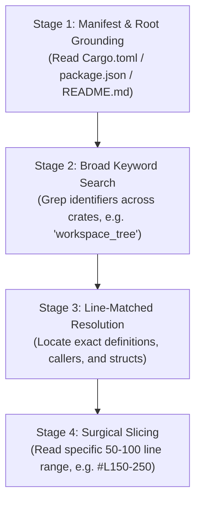
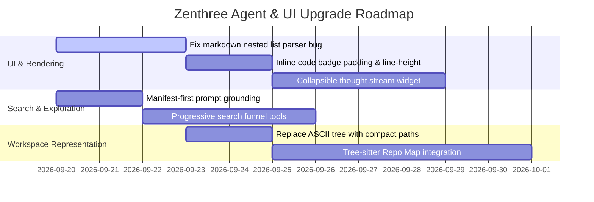

# Architectural Analysis: Agent Cognitive Behaviors, Search Dynamics, Workspace Context & UI Engineering

> **System Scope:** Zenthree AI Agent Subsystem (`crates/ai`, `crates/zenthree/src/ui_layout/ai_panel.rs`, `crates/zenthree/src/project_index.rs`)  
> **Status:** Comparative Evaluation & Improvement Blueprint  
> **Date:** September 2026

---

## Executive Summary

This document presents an in-depth comparative analysis between the baseline behavior of the **ZENE** agent and the state-of-the-art agentic interaction model demonstrated by **Antigravity**. It evaluates four critical operational pillars:

1. **Pre-Outcome Deliberation & Interleaved Thinking**: Reasoning out loud before taking action vs. instantaneous, ungrounded replies.
2. **Search Methods & Information Retrieval**: Multi-stage progressive funnels vs. shallow, scattered file peeking.
3. **Workspace Representation & Project Understanding**: The risks of static ASCII box-drawing trees vs. dynamic, Tree-sitter powered Symbol/Repo Maps.
4. **Agent UI/UX & Markdown Presentation**: Granular progressive disclosure, status pill indicators, and custom markdown rendering reliability.

---

## 1. Deliberation & Pre-Outcome Explanation ("Think Before Speaking")

### Current State (ZENE)
- **Zero Exposed Reasoning**: In the UI, ZENE jumps straight from `Worked for 18s` into the generated response. The internal chain of thought (CoT) is completely opaque.
- **Over-Formal Persona & Robotic Boilerplate**: Starts with rigid self-identification (*"Hello! I am ZENE, the lead autonomous software engineering architect for the Zenthree project."*) and closes with generic conversational filler (*"What would you like to dive into first? I can help you trace specific code paths..."*).
- **Premature Outcome Commitment**: Without a visible deliberation step, the model commits to early hypotheses without checking if its assumptions contradict reality.

### Industry Benchmark & Modern SOTA
Modern AI coding environments (e.g., Cursor Composer, Windsurf Cascade, Claude 3.7 Sonnet Hybrid Reasoning, OpenAI o3-mini) treat **intermediate deliberation** as a first-class citizen:
- **Interleaved Thinking ("Think → Act → Reflect")**: The agent reflects between tool calls. When a search returns 19 results, the model reasons about *which* result matters before opening a file.
- **Collapsible Thought Streams**: Rather than hiding thoughts or dumping them into raw chat text, thoughts are rendered in a discrete, collapsible `Thought for Xs` accordion.
- **Direct, Unembellished Tone**: SOTA developer tools dispense with conversational fluff; they lead with immediate architectural clarity.

### Improvement Blueprint for Zenthree
```rust
// Proposed Event Model in crates/ai/src/types/
#[derive(Debug, Clone, Serialize, Deserialize)]
pub enum AgentEvent {
    ThoughtChunk(String),           // Real-time streamed internal reasoning
    ThoughtFinished { duration_ms: u64 },
    ToolCallStarted { tool: String, query: String },
    ToolCallCompleted { tool: String, result_summary: String },
    TextChunk(String),              // Final user-facing markdown
}
```
1. **Stream Thinking Tokens**: In `crates/ai/src/providers/`, capture `<thought>` or thinking token streams from providers (Gemini 2.0 Flash / Pro thinking, Groq reasoning models) and dispatch them as `AgentEvent::ThoughtChunk`.
2. **Render Collapsible Thought Accordions**: In `ai_panel.rs`, render thought blocks with an accent border, muted italic typography, and a toggle chevron (`Thought for 1s ⌵`).
3. **Strip Persona Boilerplate**: Update the system prompt in `crates/ai/src/context/prompts.rs` to prohibit greeting boilerplate and canned closing questions.

---

## 2. Search Methods & Information Retrieval

### Current State (ZENE)
- **Scattered Local Peeking**: In the test run, ZENE inspected lines in 6 UI files (`state.rs #L3171-3473`, `ai_panel.rs #L740-755`, `title_bar.rs #L2-17`, `main_buffer.rs #L15-112`, `sidebar.rs #L1-35`, `theme.rs #L4-39`).
- **Absence of Root Discovery**: ZENE never ran a workspace directory scan, never read the root `Cargo.toml`, and never read `README.md`.
- **Hedged Guesswork**: Because it only read UI slices, it was forced to speculate about core engine crates (*"tree/: Likely handles document structure"*, *"connectome/: appears to handle neural-network-like weights... likely used for advanced code completion"*).

### State-of-the-Art: The Progressive Search Funnel
Top-performing coding agents use a **4-stage progressive narrowing funnel**:



### Comparative Matrix

| Feature | ZENE Baseline | Progressive Funnel (Antigravity SOTA) |
| :--- | :--- | :--- |
| **Initial Move** | Skims random UI slices from recent memory | Anchors at workspace root (`list_dir`, `Cargo.toml`, `README.md`) |
| **Search Strategy** | Ad-hoc single file reads | Broad search → Identifier grep → Definition location → Surgical read |
| **Token Efficiency** | Reads large arbitrary chunks of unrelated files | Reads only target ranges (`#L150-250`, `#L80-115`) |
| **Accuracy** | Guesses ("likely handles...") | 100% grounded in code comments and AST types |

### Improvement Blueprint for Zenthree
1. **Enforce Manifest-First Rule in Agent System Prompt**:
   ```markdown
   CRITICAL EXPLORATION RULE:
   Before explaining architecture or modifying multi-crate projects, ALWAYS inspect the root workspace manifest (`Cargo.toml`, `package.json`, or `go.mod`) and `README.md`. Never guess crate purposes from folder names alone.
   ```
2. **Implement Multi-Stage Search Tools in `crates/ai/src/tools/`**:
   - Add `search_symbol(name)` (powered by Tree-sitter or LSP).
   - Add `grep_codebase(regex, path_filter)` with match counts and line snippets.
   - Enforce bounded slice reading (`read_file_range(path, start_line, end_line)`).

---

## 3. Workspace Representation: The ASCII Tree vs. Repo Maps

### The Fatal Flaws of the Static ASCII Tree
Currently, `generate_project_tree_overview()` in `crates/zenthree/src/project_index.rs` generates an ASCII tree:
```text
.
├── assets/
│   └── fonts/
├── crates/
│   ├── ai/
│   ├── connectome/
│   │   ├── src/
│   │   │   └── lib.rs
│   │   └── weights/
│   │       └── fly_brain_500.bin
```

#### Why This Harms Agent Performance:
1. **The "Illusion of Knowledge" Trap**: When an LLM sees folder names without definitions, it assumes it understands them. This directly caused ZENE to hallucinate what `connectome` and `tree` were doing.
2. **Tokenizer Inefficiency**: Box-drawing characters (`├── `, `│   `, `└── `) take 2–4 tokens per line. Across 120 lines, **400–600 tokens are burned on visual line decoration** on every prompt.
3. **Truncation False-Negatives**: Because the tree is capped at depth 4 and 120 lines, large projects get cut off with `└── ... (more files)`. The model's grounding prompt (*"Only refer to files that exist in the tree above"*) forces it to believe omitted files do not exist.
4. **Poor Spatial Reasoning**: LLMs parse flat paths (`crates/connectome/src/lib.rs`) significantly better than reconstructing hierarchical paths from ASCII vertical bars.

### Industry Benchmark: Aider-Style Tree-sitter Repo Map
As documented in research by Aider and modern agent systems, the standard solution is an **AST-based Repository Map**:
- Uses **Tree-sitter** (already available in `crates/syntax`!) to parse files into ASTs.
- Extracts top-level declarations: `struct`, `enum`, `trait`, and public `fn` signatures.
- Formats context into a dense, structural outline:

```text
crates/connectome/src/lib.rs:
  pub struct ConnectomeWeights
  pub struct Synapse { pub pre: u16, pub post: u16, pub weight: f32 }
  pub fn from_bytes(bytes: &[u8]) -> Result<Self, String>

crates/editor/src/buffer/mod.rs:
  pub struct TextBuffer
  pub fn insert_char(&mut self, ch: char)
  pub fn delete_backwards(&mut self)
```

### Token & Quality Comparison

| Strategy | Token Cost (100 files) | Semantic Value | Risk of Hallucination |
| :--- | :--- | :--- | :--- |
| **ASCII Box-Drawing Tree** | ~1,200 tokens | Low (File & folder names only) | **High** (Invites guessing) |
| **Flat Slash Paths** | ~450 tokens | Medium (Path clarity) | Medium |
| **Tree-sitter Repo Map** | ~900 tokens | **Extremely High** (Names + Signatures + Types) | **Near Zero** (Ground truth in prompt) |

### Improvement Blueprint for Zenthree
In `crates/zenthree/src/project_index.rs`:
1. **Phase 1 (Immediate)**: Replace `build_tree_recursive` box-drawing characters with clean, compact slash paths (`crates/ai/src/lib.rs`).
2. **Phase 2 (Architectural)**: Connect `crates/syntax` to extract public symbol definitions for top files in the workspace, assembling an automated **Tree-sitter Repo Map** with an 800-token budget.

---

## 4. Agent UI/UX & Markdown Presentation

### Current Rendering Flaws in Zenthree's AI Panel
Comparing the screenshots reveals specific visual rendering bugs in Zenthree's custom GUI framework (`zenthra`) and markdown parser (`crates/zenthree/src/markdown.rs`):

```text
Expected Markdown Rendering:
1. Core Architecture
   * crates/zenthree/: Main application entry point...
   * crates/editor/: Fundamental data structures...
     * rope/: Efficient text storage

Actual Zenthree UI Rendering:
1. Core Architecture
   The project is organized into a workspace...
   • rope/ : Efficient text storage (Rope data structure).
   • buffer/ : Manages file contents and modifications.
   • tree/ : Likely handles document structure...
   [PARENTS 'crates/zenthree/' and 'crates/editor/' DROPPED ENTIRELY!]
```

#### Identified UI Bugs:
1. **Nested List Parser Failure in `markdown.rs`**:
   - The custom markdown tokenizer in Zenthree drops parent list items when they are immediately followed by an indented sub-list.
   - *Fix*: Standardize list parsing on an AST stack that pushes/pops indentation levels without discarding the parent's heading text.
2. **Excessive Inline Code Padding**:
   - Inline code spans like `crates/zenthree/src/main.rs` render with heavy block-level margins that distort text line-height.
   - *Fix*: Tune badge padding to `2px 6px` with rounded `3px` corners and sub-pixel vertical centering in `ui_layout/ai_panel.rs`.
3. **Lack of Dynamic Tool Pill Indicators**:
   - In Antigravity's UI, searches render as compact status pills: `Searched workspace_tree` `19 results`.
   - Zenthree currently lacks distinct pill badges for tool query counts and language icons (`🦀`, `Ⓡ`).

---

## 5. Comprehensive Action Plan for Zenthree



### Summary of Targeted File Changes

1. **[`crates/zenthree/src/markdown.rs`](file:///home/kabir/Desktop/projects/personal/framworks/zenthra-v2/apps/zenthree/crates/zenthree/src/markdown.rs)**: Fix parent list item omission during nested list indentation parsing.
2. **[`crates/zenthree/src/ui_layout/ai_panel.rs`](file:///home/kabir/Desktop/projects/personal/framworks/zenthra-v2/apps/zenthree/crates/zenthree/src/ui_layout/ai_panel.rs)**: Add `Thought for Xs` accordion component and discrete tool execution badges with count pills.
3. **[`crates/zenthree/src/project_index.rs`](file:///home/kabir/Desktop/projects/personal/framworks/zenthra-v2/apps/zenthree/crates/zenthree/src/project_index.rs)**: Deprecate box-drawing ASCII in favor of flat slash paths and Tree-sitter symbol outlines.
4. **[`crates/ai/src/context/prompts.rs`](file:///home/kabir/Desktop/projects/personal/framworks/zenthra-v2/apps/zenthree/crates/ai/src/context/prompts.rs)**: Update system instructions to eliminate persona boilerplate and enforce manifest-first exploration.
