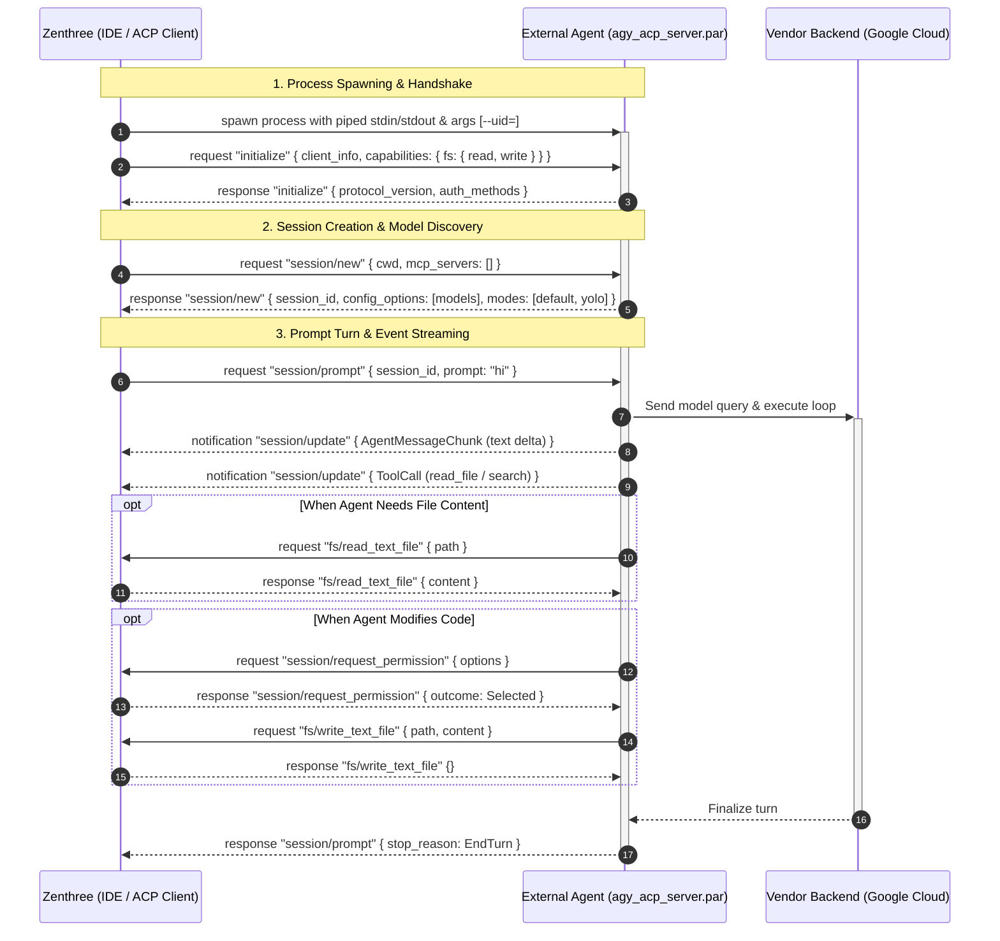

# External Agents & Agent Client Protocol (ACP) Architecture

> **Component:** `agent::external_provider::acp`, `agent::external_provider::antigravity_cli`, `zenthree::ui_layout::ai_settings_dialog`  
> **Status:** Production / Implemented  
> **Protocol Standard:** [Agent Client Protocol (ACP) v1 / v2](https://github.com/agent-client-protocol/agent-client-protocol) via official `agent-client-protocol = "2.2.0"` crate.

---

## 1. Overview & Architectural Goals

The **Agent Client Protocol (ACP)** is an open, JSON-RPC 2.0-based protocol designed to connect code editors and IDEs (clients) with autonomous AI agents (servers). 

In Zenthree, the external agent architecture fulfills three core objectives:
1. **Out-of-Process Isolation:** External agents run as standalone OS child processes. If an agent crashes or hangs, the editor remains completely unaffected.
2. **Zero-Credential-Proxy Security Model:** Zenthree **never** touches, inspects, stores, or proxies user authentication tokens or secrets. The agent binary handles its own OAuth login flow, credential storage, and cloud backend communication directly with the vendor (e.g. Google).
3. **Client-Delegated Capabilities:** Agents plan changes and reason about code, but all actual file system mutations (`read`, `write`) and security approvals (`request_permission`) are delegated back to Zenthree.

---

## 2. Protocol Lifecycle & Communication Flow

Communication between Zenthree and the agent occurs over `stdin` and `stdout` using JSON-RPC 2.0 messages:



---

## 3. Client Capabilities & Handlers

ACP is a client-delegated protocol. In [`crates/agent/src/external_provider/acp/client.rs`](file:///home/kabir/Desktop/projects/personal/framworks/zenthra-v2/apps/zenthree/crates/agent/src/external_provider/acp/client.rs), Zenthree implements the following client-side RPC handlers:

### 3.1 `fs/read_text_file`
* When the agent needs to inspect a source file in the user's workspace, it calls `fs/read_text_file` with `{ path }`.
* Zenthree reads the file safely from the local file system and returns the UTF-8 text string to the agent.

### 3.2 `fs/write_text_file`
* When the agent applies an edit or creates a new file, it calls `fs/write_text_file` with `{ path, content }`.
* Zenthree ensures parent directories exist and writes the contents to disk.

### 3.3 `session/request_permission`
* When the agent invokes sensitive operations (e.g. running terminal commands or modifying protected directories), it requests permission from Zenthree.
* Zenthree resolves permissions based on active security policy (interactive user confirmation or configured auto-approval for safe development directories).

---

## 4. Google Antigravity Provider Integration

Zenthree's primary external agent implementation is **Google Antigravity** (`agy_acp_server.par`), offering access to Google's latest Gemini models.

### 4.1 The Linux `--uid=` Launch Flag Fix
* **The Problem:** Google's `agy_acp_server.par` includes launcher initialization logic (`init_google.cc`). When spawned on Linux systems without `--uid=`, it attempts to switch its UID and GID to user `nobody` and group `nobody`. On Debian, Ubuntu, and Pop!_OS systems, user `nobody` belongs to group `nogroup` (group `nobody` does not exist). This caused an immediate fatal process crash:
  ```text
  LookupGIDByGroupName(groupname, &new_gid) Group nobody not found
  ```
* **The Solution:** In [`AcpAgentConfig::suggest_antigravity()`](file:///home/kabir/Desktop/projects/personal/framworks/zenthra-v2/apps/zenthree/crates/agent/src/external_provider/acp/config.rs), `--uid=` is automatically passed as a command argument on Linux. This instructs the binary not to perform any privilege transitions, allowing it to run normally under the current user's UID and GID.

### 4.2 Dynamic Binary Detection
Zenthree locates `agy_acp_server.par` through a cascading fallback order:
1. Environment variable override: `$ANTIGRAVITY_AGENT_PATH`.
2. Standard system `$PATH` lookup: `which agy_acp_server.par`.
3. User application directories:
   * `~/.local/share/zed/external_agents/registry/antigravity-acp/*/agy_acp_server.par`
   * `~/.gemini/antigravity-acp/bin/agy_acp_server.par`

### 4.3 Credential Storage & Isolation
* Antigravity stores its own OAuth tokens in `~/.gemini/antigravity-acp/acp_token.json`.
* Setting the `$GEMINI_HOME` environment variable allows complete profile isolation between different applications if separate accounts or quotas are desired.
* Interactive login is handled via `agy login` or through ACP's native OAuth personal browser flow.

---

## 5. Dynamic Model Discovery & Capabilities

Rather than hardcoding model names or assuming fixed rate limits, Zenthree dynamically queries the agent during `session/new`:

### 5.1 Discovered Models
| Model Identifier | Display Name | Characteristics |
| :--- | :--- | :--- |
| `gemini-3.8-flash-high` | Gemini 3.8 Flash (High) | Ultra-fast latency with dynamic thought reflection & high reasoning. |
| `gemini-3.8-flash-medium` | Gemini 3.8 Flash (Medium) | Balanced speed and reasoning for general software engineering. |
| `gemini-3.8-flash-low` | Gemini 3.8 Flash (Low) | Lowest latency; ideal for quick refactors, lint fixes, and unit tests. |
| `gemini-3.7-flash-high` | Gemini 3.7 Flash (High) | High-reasoning multimodal engine. |
| `gemini-pro-agent` | Gemini 3.1 Pro (High) | Deep reasoning engine for complex architectural refactors and multi-file tasks. |
| `gemini-3.1-pro-low` | Gemini 3.1 Pro (Low) | Pro-tier model optimized for fast responses. |

### 5.2 Agent Modes
* `default`: Standard collaborative agent loop with permission checks.
* `auto_edit`: Streamlined code generation with automated file diff application.
* `yolo`: Autonomous execution mode for rapid development.

---

## 6. Codebase File Structure

```text
crates/agent/src/
├── external_provider/
│   ├── mod.rs                        # Module exports and provider builders
│   ├── acp/                          # Generic ACP Client Engine
│   │   ├── mod.rs                    # ACP public exports
│   │   ├── config.rs                 # AcpAgentConfig & suggest_antigravity()
│   │   ├── types.rs                  # AcpModel, AcpMode, AcpEvent
│   │   └── client.rs                 # AcpClient (subprocess, RPC loop, FS handlers)
│   └── antigravity_cli/              # Google Antigravity Provider Wrapper
│       ├── mod.rs                    # Antigravity provider entrypoint
│       ├── auth.rs                   # AntigravityAuthManager & token checks
│       ├── models.rs                 # ModelInfo & available_models()
│       └── provider.rs               # AntigravityCliProvider (bridges to Provider trait)
└── bin/
    ├── acp_spike.rs                  # Standalone raw ACP verification binary
    └── main.rs                       # zene CLI binary with -p antigravity support

crates/zenthree/src/
├── state/
│   ├── types.rs                      # AiModel enum with Antigravity entries
│   └── ai.rs                         # Conversation runner & thread orchestration
└── ui_layout/
    ├── ai_settings_dialog.rs         # External Agents tab & model selection UI
    └── ai_panel.rs                   # Chat panel with streaming updates
```

---

## 7. Testing & Verification

### 7.1 Running the Live ACP Unit Test
Run the automated integration test that verifies binary detection, spawning, handshake, session initialization, and prompt streaming:
```bash
cargo test -p agent test_acp_client_antigravity -- --nocapture
```

### 7.2 Testing via CLI (`zene`)
Test model listing:
```bash
cargo run -p agent --bin zene -- --list-models
```

Run a live prompt turn through the external agent:
```bash
cargo run -p agent --bin zene -- -p antigravity "write a rust function that checks if a number is prime"
```

### 7.3 Testing in the Graphical Editor (`zenthree`)
1. Run `cargo run -p zenthree`.
2. Open the **AI Settings** dialog (gear icon in the AI panel).
3. Navigate to the **External Agents** tab.
4. Verify connection status, select an Antigravity model, and click **Set as Active Model**.
5. Start chatting in the AI panel.
