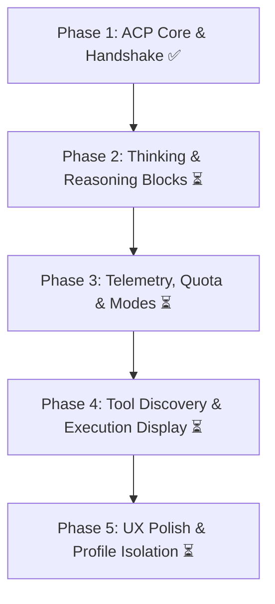

# Google Antigravity Integration: Evolution & Feature Roadmap

> **Document:** `docs/external_agent/antigravity.md`  
> **Target:** Google Antigravity ACP Agent (`agy_acp_server.par`)  
> **Status:** Phase 1 Complete (Protocol Handshake, Basic Streaming, Auth & Models) | Roadmap for Phase 2 & Beyond

---

## Roadmap Overview

Now that the core Agent Client Protocol (ACP) infrastructure is operational and verified end-to-end, this roadmap outlines the evolution of the Antigravity integration across thinking/reasoning visualization, model/quota telemetry, tool orchestration, and UX customization.

---

## 1. Thinking & Reasoning Blocks (Phase 2A: Default ACP Stream)

Antigravity models (specifically `gemini-3.8-flash-high` and `gemini-pro-agent`) emit extensive Chain-of-Thought (CoT) reasoning before producing final code or explanations.

### Implementation Goals:
* **Capture Native Thought Streams:** Listen for ACP `session/update` notifications containing `ContentBlock::Thought` / `ThoughtDelta` events.
* **First Step — Default Presentation:** 
  * Initially stream thoughts in their raw native format directly above the response text.
  * Show a subtle real-time typing/generation indicator (`Thinking...`).
  * Ensure the thought buffer does not mix into the final markdown assistant turn.

---

## 2. Thinking UI Styling: Default vs. Zene Native Style (Phase 2B)

Offer flexible presentation based on user preference:

### Path A: Default Standard View
* If the user prefers the clean, minimal default, render a collapsible toggle:
  * `[> Thought process (1.2s)]`
  * Clicking expands the raw reasoning log with monospaced subtle text.

### Path B: Zene Sensory / Bio-Connectome Style
* If the user opts for Zene's signature aesthetic:
  * Render an animated, glassmorphic reasoning block with subtle accent glowing borders.
  * Display step-by-step reasoning bullets as they are formulated in real-time.
  * Include execution micro-stats: reflection latency, token output velocity, and intent tags.
* **User Setting:** Add a toggle in **AI Settings → External Agents**:
  * `Thinking Display Style: [ Default Minimal | Zene Enhanced ]`

---

## 3. Model Discovery, Agent Modes & Quota Telemetry (Phase 3)

Provide full visibility into dynamic agent capabilities and usage limits directly in the editor.

### 3.1 Dynamic Model Discovery & Switching
* Automatically synchronize models on startup via `session/new` without hardcoded lists.
* Support instant runtime model switching without terminating the ACP daemon.

### 3.2 Agent Modes Support
Expose Antigravity's three distinct operating modes in the chat header:
1. **`default` (Collaborative):** Interactive mode with safety confirmations and turn checkpoints.
2. **`auto_edit` (Direct Mutation):** Streamlined code editing where diffs are automatically applied to the workspace.
3. **`yolo` (Autonomous):** Full autonomous agent execution with automatic permission granting for fast iteration.

### 3.3 Quota, Limits & Reset Countdown
* **Error & Limit Interception:** Intercept ACP `UsageLimitReached` / quota notifications.
* **Visual Telemetry Banner:**
  * When quota is exhausted, display a clean, non-intrusive warning card in the AI panel:
    > ⚠️ **Google Quota Limit Reached**  
    > *Your quota will reset in: 2 days, 15 hours.*
  * Provide quick action buttons: **Switch to Gemini API Key** or **Switch to Groq**.

---

## 4. Tool Discovery & Visual Execution Pipeline (Phase 4)

Antigravity plans and calls tools internally (code searching, symbol analysis, terminal execution) while delegating filesystem operations to Zenthree.

### Implementation Goals:
* **Live Tool Call Notifications:**
  * Listen for `ToolCall` events in `session/update`.
  * Extract tool names (e.g. `search_codebase`, `read_text_file`, `terminal_exec`).
* **Visual States in Chat Trajectory:**
  * 🟡 **Pending:** `[Tool: read_file] Preparing request...`
  * 🔵 **In Progress:** `[Tool: search_codebase] Searching "struct AcpClient"...`
  * 🟢 **Completed:** `[Tool: write_text_file] Updated crates/agent/src/lib.rs (+24 -2)`
  * 🔴 **Failed / Rejected:** `[Tool: terminal] Permission denied by user`
* **Interactive Diffs:** Before `fs/write_text_file` commits to disk, show an in-editor split diff preview when in `default` mode.

---

## 5. Advanced Improvements & Future Enhancements (Phase 5)

### 5.1 Account & Profile Isolation via `$GEMINI_HOME`
* Allow users to manage multiple Google accounts across projects.
* Support custom credential directories (`$GEMINI_HOME=/path/to/profile`) in `AcpAgentConfig` so users can separate personal quotas from work or team accounts.

### 5.2 Slash Commands Dynamic Registration
* Dynamically query slash commands exposed by the agent during session negotiation (e.g. `/init`, `/compact`, `/mode`, `/help`).
* Autocomplete slash commands in the Zenthree chat input when `/` is typed.

### 5.3 Multi-Agent Registry Selector
* Extend the External Agents settings tab into a general ACP registry where users can add any custom ACP agent:
  * Google Antigravity (`agy_acp_server.par`)
  * Claude Code ACP bridge
  * Custom local agent binaries or remote sockets
